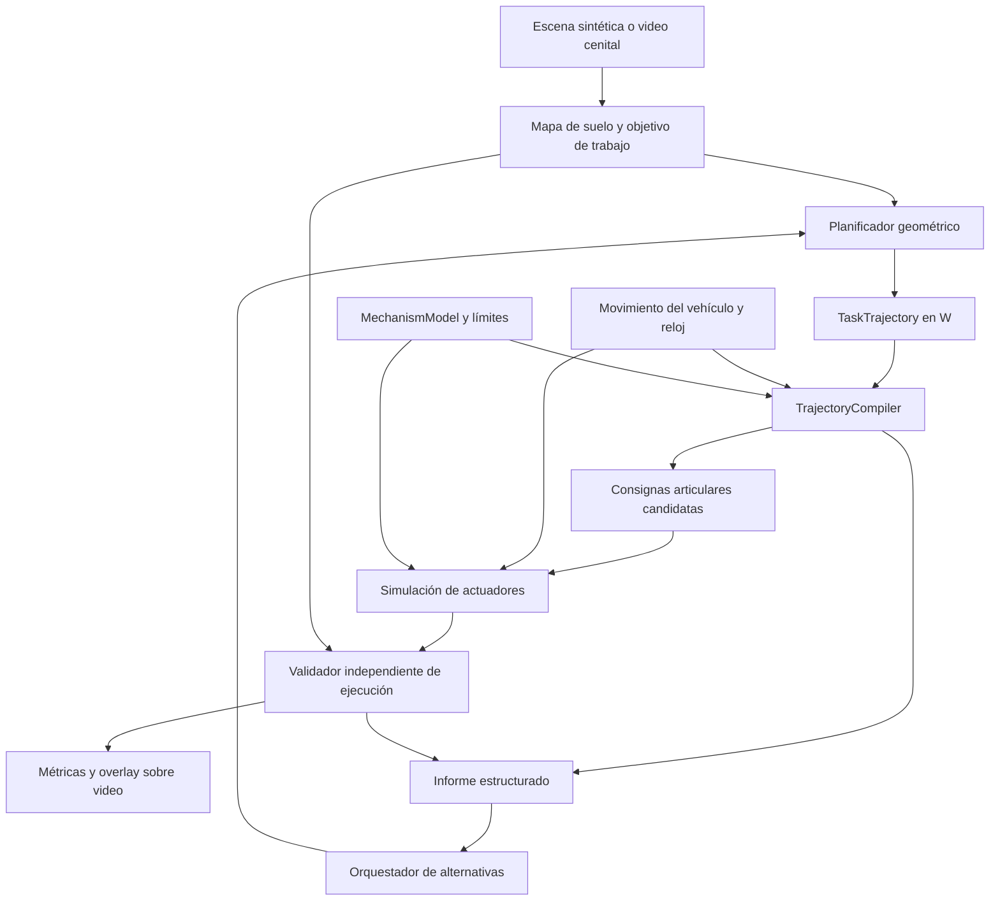

# Adaptación arquitectónica: trayectorias de tarea y mecanismos independientes

**Fecha:** 24 de octubre de 2026. **Revisión:** 2, profundización de la revisión técnica.  
**Estado:** propuesta técnica; no implementa cambios en producción.  
**Decisión del usuario:** planificación independiente del mecanismo, baseline de brazo oscilante de un pivote y simulación offline sobre videos cenitales. Extensibilidad posterior a giro/elevación y dos brazos.

## 1. Resultado del análisis

El desacoplamiento es viable sin rehacer E1. El planificador describe **qué trabajo se desea en suelo W**; un compilador, usando un modelo de mecanismo y movimiento del vehículo, determina **si puede realizarse y cómo accionarlo**. La simulación y un validador independiente comprueban la ejecución resultante. Un candidato geométrico no equivale a una trayectoria ejecutable ni a una ejecución validada.

Hay una restricción fundamental: un brazo rígido de una articulación no controla libremente X, Y y orientación. Su punto de referencia recorre un arco **respecto del vehículo**, mientras que en W ese arco se desplaza y gira con el vehículo. La orientación de la cuchilla rígidamente montada depende del mismo ángulo. No basta introducir una interfaz de IK sobre la planificación cartesiana existente: hay que expresar orientación opcional, tolerancias de tarea, tiempo y rechazos verificables.

Se corrigen cinco puntos de la propuesta anterior: `W` no puede contener coordenadas `image_px`; tiempo y progreso no son intercambiables; ralentizar una trayectoria con base móvil puede destruir alcanzabilidad; dos brazos pueden accionar una sola cuchilla en cadena cerrada; la validación debe incluir brazos/cuerpos, además de la cuchilla. También se elimina la exigencia de una singularidad ficticia del baseline 1R y la afirmación obsoleta de que el dictamen E1 aún no existía.

## 2. Estado comprobado e impacto mínimo

La fuente principal es el código, contrastado con el plan maestro, contratos, entrega de E1 y [dictamen E1 actualizado](reviews/E1_review.md). Se conservan los hashes de los 45 archivos del snapshot anterior. Suite oficial: **200 aprobadas**; evidencia adversa: **9 casos originales y 20 adicionales fallidos**. E1 sigue pendiente de correcciones R1–R12. La adaptación no las sustituye.

Actualmente existen contratos geométricos, configuración, escenarios, transformaciones, geometría/estado planar de herramienta y demo estática. No hay todavía planificador E2 ni mecanismo articulado E3. Los límites X–Y de `KinematicsConfig` describen un cursor cartesiano, **no una implementación de brazo oscilante**. El baseline 1R se valida aquí como especificación matemática futura, no como software ya entregado ni diseño mecánico medido.

| Elemento | Conservar | Adaptación necesaria y momento |
|---|---|---|
| `core/types.py`, `units.py`, `errors.py` | Puntos, dominios, exclusiones, corredor, incertidumbre | Corregir invariantes E1; añadir contratos de tarea separados en A1. |
| `geometry/frames.py` | Álgebra rígida y composición | Conservar API planar. Añadir identidad de instancia para varias herramientas al necesitarla; no convertirla apresuradamente en motor 3D. |
| `simulation/tool.py:ToolGeometry` | Polígonos de corte/colisión, offsets y utilidades | Corregir propiedad de datos y referencia local. Extraer perfil a `geometry/` solo cuando el planner lo consuma. |
| `ToolState`, `world_footprints` | Estado cartesiano y colocación para fixtures/render | Usarlos como vista derivada/compatibilidad; no reinterpretar `position.x/y` como articulaciones. |
| `scenarios/`, demo y tests actuales | Escenas E1, SVG sin escala y regresiones | Corregir contratos; añadir fixtures mecánicos en A3, sin redimensionar silenciosamente las escenas para que pasen. |
| `ToolConfig` | Dimensiones y geometría local | Orientación fija es política de tarea o montaje, no propiedad universal de la forma. Conservar versión antigua explícita. |
| `KinematicsConfig`, YAML | Fixture cartesiano documentado | Crear esquema de mecanismo y actuadores. No convertir límites lineales en angulares por renombre. |
| E2 del plan maestro | Planificación geométrica y barrido | Salida exclusivamente de tarea; aprobación geométrica independiente de viabilidad mecánica. |
| E3 del plan maestro | Temporalidad, seguimiento, latencia, validación | Sustituir supuesto de control X–Y/orientación fija por compilación 1R y actuadores articulares mediante ADR. |
| E0/E4/E5 y video | Caracterización, PTS, calibración, anotación y tracking | Mismo replay offline; separar montaje de cámara y mecanismo. |

El plan maestro continúa vigente en lo no modificado. Durante A1 se actualizarán mediante ADR las secciones incompatibles con 1R, sus contratos y criterios E3; no dejar dos especificaciones contradictorias. La instrucción del usuario define el mecanismo inicial, pero no proporciona dimensiones físicas. Empezar con parámetros sintéticos explícitos.

## 3. Responsabilidades y dependencias



- **Planificador:** mapa, región conocida, exclusiones, objetivo, perfil de trabajo y restricciones de tarea. Produce candidatos deterministas; no importa `kinematics` ni actuadores, no consulta longitudes/juntas, no abre video ni llama a IK.
- **Modelo mecánico:** topología, parámetros, configuraciones válidas, cinemática directa y geometría de todos los cuerpos relevantes. No elige rutas agronómicas.
- **Compilador:** vincula roles de tarea a herramientas; resuelve configuraciones, continuidad, tiempos y límites dados el movimiento del vehículo y estado inicial. No cambia silenciosamente la tarea.
- **Simulador:** aplica retardo, saturación y respuesta especificada a las consignas; reconstruye estados reales simulados mediante FK. No confunde consigna con movimiento obtenido.
- **Validador:** verifica restricciones articulares, residuo de tarea, barridos, corredor, incertidumbre, cobertura y contacto de la ejecución. No acepta como prueba el indicador de éxito del solver.
- **Orquestador:** selecciona modelo y binding, prueba alternativas con presupuesto acotado y conserva todos los resultados. Puede solicitar variantes de tarea usando restricciones expresadas en suelo, nunca pasar `q` o identidad de brazo al planificador.

El planificador puede recibir una agenda de vehículo exógena o ventanas de trabajo expresadas en W si la tarea requiere anticipación; esto no lo convierte en modelo de mecanismo. Para iguales mapa/perfil/requisitos/semilla debe producir los mismos candidatos aunque cambie el mecanismo. La selección final y cobertura conseguida sí pueden variar.

## 4. Contratos propuestos

Son especificaciones para A1–A3, no APIs ya implementadas. Versionar schemas y rechazar dimensiones/unidades ambiguas. No llenar el repositorio de interfaces vacías antes de sus consumidores.

### 4.1 Marcos, unidades, identidad y procedencia

`T_AB` transforma coordenadas de B a A. `W` es suelo, con X lateral y Y longitudinal según la convención documentada; `V` vehículo; `A_j` montaje/articulación; `B_i` referencia local de herramienta. La composición única es:

`T_WB_i(t) = T_WV(t) · T_VB_i(q(t))`.

La coordenada del origen de `B_i` en sí mismo es cero. El pivote físico `A_j` puede estar en cualquier posición conocida de V. No confundir ese pivote con el campo local `ToolGeometry.pivot` de E1 ni aplicar dos veces el offset de la cuchilla.

Para video/múltiples herramientas, identificar instancia y versión de marco, segmento de W, reloj y calibración; dos marcos llamados W de clips distintos no son automáticamente el mismo. Mantener el enum actual donde sea suficiente; extender con un identificador de instancia cuando se introduzcan esos consumidores.

`TaskTrajectory` usa W y metros, con procedencia `ground_metric_synthetic`, `ground_assumed` o `ground_metric_verified`. Son modos separados: supuesto no es medido. Píxeles pertenecen a I y el SVG a su dominio gráfico. Se permiten previews en esos espacios mediante otro contrato, sin compilar sus coordenadas como metros. Una escala asumida puede habilitar un experimento métrico hipotético debidamente rotulado, nunca evidencia de precisión física.

### 4.2 `TaskTrajectory`: requisitos de suelo, no articulaciones

Campos obligatorios: versión/ID, mapa y perfil versionados, marco/dominio, referencia temporal, horizonte, roles de trabajo, curva e interpolación especificadas, restricciones de orientación/contacto, tolerancias y condición mínima de trabajo. Arrays propios/inmutables y valores finitos; intervalos/tiempos ordenados y sin ambigüedad.

Separar geométricamente `TaskPath: p(s), s∈[0,1]` de su temporalidad. `s` es progreso adimensional, no segundos ni coordenada Y. Las derivadas respecto de s no son velocidades. El contrato temporal será una unión discriminada:

| Modo | Significado | Libertad del compilador |
|---|---|---|
| `TIMED_REFERENCE` — primero a implementar | `p_d(t)` y restricciones con reloj/horizonte explícitos | No cambiar tiempos. Ajustar dentro de tolerancia de tarea declarada o rechazar. |
| `PATH_WITH_WINDOWS` — extensión posterior | `p(s)` y ventanas/eventos temporales explícitos | Resolver conjuntamente `s(t)` y `q(t)` con `T_WV(t)`; no asumir retiming libre. |

No aceptar puntos sueltos sin definir interpolación: los bordes y límites se verifican también entre muestras. Declarar continuidad por tramo y transiciones; conservar C2 durante trabajo donde lo exige E2. Maniobras de inicio/fin deben enlazar con estado real sin saltos.

La orientación es una restricción explícita `FIXED`, `INTERVAL` o `FREE`, incluyendo marco y semántica angular. `FREE` no significa cero. Para 1R, exigir simultáneamente posición arbitraria y yaw fijo suele hacer la tarea imposible; no añadir otro grado de libertad ficticio para cumplirla.

La tolerancia de seguimiento define un tubo admisible de tarea. El compilador puede hallar un movimiento dentro de ese tubo si el contrato lo permite; debe exportar residuo y verificar cobertura. No puede proyectar objetivos al arco fuera de esa tolerancia, mover exclusiones, ampliar el tubo ni reducir protección. Un desplazamiento permitido respecto de la ruta ideal tampoco elimina la necesidad de validar huellas reales.

### 4.3 Perfil de trabajo y vinculación de herramientas

`ToolProfile` contiene referencia local, huella de corte y huella de colisión de la herramienta, con unidades/procedencia. No contiene pivote del brazo, longitudes de eslabones, límites de motor ni topología. La huella de colisión debe contener la de corte. Brazos y transmisiones se describen en el modelo mecánico, no en este perfil compartido.

Si la orientación es libre, el planner puede usar una envolvente conservadora de todas las orientaciones permitidas (por ejemplo, disco de radio máximo respecto de B). Si también permite un tubo de posición, incluirlo en su cota previa o etiquetar claramente que la seguridad geométrica solo corresponde a la referencia. En cualquier caso, la aprobación final usa orientación y posición ejecutadas. Una envolvente conservadora puede rechazar trabajo factible; eso no prueba imposibilidad física.

Roles como `franja_izquierda` o `pasada_principal` describen la tarea, no motores. `TaskBinding`, propiedad del orquestador/compilador, asocia roles a `B_i` y perfiles compatibles, con exclusividad, simultaneidad o secuencia explícitas. Dos roles no implican dos articulaciones, ni dos brazos implican dos herramientas. Si el compilador inicial no soporta una asignación múltiple, responde `UNSUPPORTED`, no inventa factibilidad o imposibilidad universal.

### 4.4 `MechanismModel`: configuraciones y todos los cuerpos

Contrato conceptual:

```text
configuration_schema -> articulaciones, orden, tipo, unidades, límites y acoplamientos
validate_configuration(q, assembly_mode) -> restricciones y residuos
forward(q, assembly_mode) -> poses de herramientas y cuerpos en V
[opcional] inverse_seeds(target_constraints, seed) -> candidatos y alcance de búsqueda
[opcional] jacobian(...) -> derivadas con marco y convención declarados
```

`q` tiene dimensión declarada; juntas rotacionales en radianes, prismáticas en metros. Distinguir articulaciones activas/pasivas, configuración completa y vector de comandos. Para cadenas cerradas incluir restricciones `g(q)=0`, desigualdades, modos de ensamblaje y dependencias. FK debe indicar qué estado completo necesita y cómo resuelve variables pasivas, sin seleccionar una rama oculta arbitrariamente.

La salida contiene poses por `body_id` y `tool_id`, geometría de colisión asociada y frame/unidad. Validar brazo–cultivo, autocolisión e interherramienta requiere eslabones, no solo poses de cuchilla. Pares de contacto estructural permitidos deben declararse de forma específica; no excluir de colisión todos los cuerpos del mismo mecanismo.

No exigir una lista finita y exhaustiva de IK para todo modelo: un mecanismo redundante puede tener un continuo de soluciones. El modelo puede proporcionar semillas, solución analítica o restricciones; el compilador administra la búsqueda y declara su alcance. ID, versión, parámetros y hash del modelo se registran en la ejecución, no dentro del planificador.

### 4.5 `TrajectoryCompiler` y resultados

Entradas: `TaskTrajectory`, `TaskBinding`, `VehicleMotion`, modelo, límites de actuadores, estado inicial, reloj/latencias, mapa y presupuestos versionados necesarios para restricciones. `VehicleMotion` contiene `T_WV(t)`, derivadas requeridas, incertidumbre, intervalo válido y origen predicho/referencia. Una pose aislada no basta para decidir límites temporales.

Pasos: validar contratos → transformar objetivos con el movimiento de base → resolver IK/restricciones → seleccionar continuidad desde estado inicial → resolver temporalidad permitida → comprobar límites y residuos → producir candidato y evidencia. Comprobar configuración completa y cuerpos, no solo la junta actuada.

`ExecutableTrajectory` representa consignas temporales para simulación: articulaciones actuadas, configuración completa de referencia, derivadas, interpolación, modo de ensamblaje, estados de operación, condición inicial/final, trazabilidad tarea↔tiempo y errores de ajuste. El nombre no equivale a una autorización de maquinaria. Su estatus debe seguir siendo candidato hasta el rollout y validación.

| Estado de compilación | Uso correcto |
|---|---|
| `FEASIBLE_CANDIDATE` | Solución encontrada bajo modelo/restricciones declaradas; falta validar ejecución simulada. |
| `INFEASIBLE_PROVEN` | Contradicción demostrada para el problema y tolerancias declarados; adjuntar certificado, por ejemplo alcance radial analítico. |
| `NOT_FOUND_WITHIN_LIMIT` | Búsqueda agotada o solver sin solución; no prueba inexistencia. |
| `UNSUPPORTED` | Modelo, modo temporal o combinación aún no implementados. |
| `INVALID_INPUT` | Unidades, dimensiones, marcos, tiempos o procedencia inválidos. |
| `UNCERTIFIED` | No se puede acotar o validar un intervalo/modelo requerido. |

La simulación produce `ExecutionTrace` con `q_actual(t)` y poses por FK. Solo un `ValidationReport` satisfactorio permite `ValidatedExecution`, ligado a hashes de tarea, modelo, mapa, calibración, trayectoria y configuración de actuadores. Modificar una entrada invalida ese resultado. Límites de velocidad/aceleración y un modelo de retardo no certifican torque, fuerza de corte ni dinámica estructural: esas magnitudes quedan fuera hasta contar con modelo y parámetros.

### 4.6 `InfeasibilityReport`: fallos auditables

Campos: versión, estado global, código, etapa que lo detecta, rol/cuerpo/junta cuando aplique, intervalo en t y/o s con unidades, valor observado, límite y tolerancia, residual, método, tipo/alcance de certificado, presupuesto de búsqueda, hashes y condición inicial. Ejemplos de código: `RADIAL_REACH`, `ORIENTATION_CONFLICT`, `JOINT_LIMIT`, `VELOCITY_LIMIT`, `ACCELERATION_LIMIT`, `CLOSURE_ERROR`, `BRANCH_DISCONTINUITY`, `COLLISION`, `INSUFFICIENT_LOOKAHEAD`, `UNKNOWN_SPACE`.

Separar causa y fuerza de la conclusión: `RADIAL_REACH` puede llevar prueba analítica; no convergencia numérica no. `NO_PATH_FOUND` pertenece al resultado del planner y tampoco prueba imposibilidad. El orquestador traduce motivos mecánicos a solicitudes alternativas de tarea solo cuando exista una traducción justificada; los diagnósticos articulares permanecen disponibles para auditoría sin filtrarse a la API geométrica.

## 5. Baseline de brazo oscilante 1R

### 5.1 Definición y cinemática

Elegir una convención sintética verificable: pivote `a=(a_x,a_y)` fijo en V, longitud efectiva `L>0`, ángulo `q` medido desde +X de V en sentido antihorario y offset angular de montaje `β`. El origen B está a distancia L del pivote; el polígono puede tener offset respecto de B. Una orientación fija adicional del montaje del eje se absorbe explícitamente en el cero de q.

```text
T_VB(q) = Trans(a_x,a_y) · Rot(q) · Trans(L,0) · Rot(β)
p_B^V(q) = a + L (cos q, sin q)
θ_B^V(q) = q + β
T_WB(t) = T_WV(t) · T_VB(q(t))
```

Con `T_WV=(R(t),p_V(t))`, para una referencia exacta `p_d^W(t)` definir:

```text
r(t) = R(t)^T [p_d^W(t) − p_V(t)] − a
||r(t)|| = L
q(t) = atan2(r_y,r_x) + 2πk, dentro de límites y continuo desde q inicial
θ_d^W(t) = θ_V^W(t) + q(t) + β, si la tarea restringe orientación
```

El test de norma es necesario; límites, orientación, continuidad y derivadas añaden restricciones. Con tolerancia de posición, buscar una solución dentro del tubo y comprobarla; no reemplazar automáticamente `r` por su proyección radial. No asumir que todo punto dentro del disco es alcanzable: para longitud fija el lugar exacto es el arco, no el disco.

Para radio exacto y trayectorias diferenciables:

`q̇ = (r_x ṙ_y − r_y ṙ_x)/L²`, con `r·ṙ=0`;  
`q̈ = (r_x r̈_y − r_y r̈_x)/L²`.

Las derivadas de r incluyen traslación **y rotación** del vehículo. Evaluarlas solo sobre el camino en W omite parte del movimiento exigido a la junta. El Jacobiano planar es `L(-sin q, cos q)^T`: para `L>0` tiene rango 1 en todo q. La falta de dos grados de libertad cartesianos es subactuación respecto de esa tarea, no una singularidad aislada. El salto de `atan2` en ±π es representación; gestionar desenvolvimiento y límites físicos. `L=0` es configuración de modelo inválida. La distinción entre rango máximo del mecanismo y pérdida de rango sigue la definición de [Modern Robotics, §5.3](https://modernrobotics.northwestern.edu/nu-gm-book-resource/5-3-singularities/); las ecuaciones específicas anteriores son derivación de este modelo propuesto.

### 5.2 Por qué no sirve ralentizar sin volver a resolver

Contraejemplo sintético: `a=0`, `L=0.4 m`, vehículo sin rotación con `p_V(t)=(0,0.2t) m`. La referencia `p_d(t)=(0.4,0.2t)` es alcanzable con `q=0`. Si se ralentiza solo la tarea a `(0.4,0.1t)` manteniendo el vehículo, resulta `r=(0.4,−0.1t)` y `||r||>0.4` para cualquier `t>0`.

Por tanto, reparametrizar una ruta o aplicar un algoritmo de retiming de base fija no conserva automáticamente alcanzabilidad ni colisiones. En `TIMED_REFERENCE` se rechaza si no cumple. En `PATH_WITH_WINDOWS` resolver conjuntamente `s(t)`, `q(t)` y la agenda externa `T_WV(t)`; verificar de nuevo alcance, derivadas y barrido. Cambiar velocidad del vehículo solo sería otra capacidad explícita del sistema, fuera del baseline: no inventarla para hacer pasar el caso.

### 5.3 Fixtures y alcance de aceptación

Mantener las escenas E1 como pruebas geométricas. Añadir fixtures con montaje/longitud sintéticos declarados y oráculos independientes:

- FK e IK de ángulos conocidos, vehículo trasladado/rotado y offset de cuchilla; error absoluto `<=1e-9` en casos bien condicionados, con `rel=0`.
- Punto en arco, dentro del disco pero fuera del arco, fuera del radio, fuera del intervalo angular y orientación incompatible.
- Continuidad al cruzar representación ±π, sin salto físico ni falsa rama de codo; respetar topes de la junta.
- Trayectoria analítica `q(t)=q0+A·sin(ωt)` con `|Aω|` y `|Aω²|` conocidos, y movimiento de vehículo declarado. Generar su objetivo por ecuaciones independientes de la función FK bajo prueba.
- Contraejemplo temporal anterior, estado inicial incompatible, latencia excesiva y cuerpo del brazo que colisiona aunque la cuchilla esté libre.
- Al menos una integración con cobertura/progreso positivos exigidos, barrido continuo seguro y ejecución válida; rechazo de todo no satisface A3. Añadir tareas no factibles y conservar la causa del rechazo.

Los fixtures derivados de FK prueban el compilador, no que un planner genérico encuentre una ruta útil. La integración adicional debe partir del mapa y de candidatos de E2, sin editar a posteriori sus exclusiones. Un conjunto acotado de variantes puede no contener una solución; declararlo así, sin afirmar imposibilidad universal.

## 6. Seguridad geométrica, contacto y ejecución

La validación reconstruye cada cuerpo con FK y movimiento del vehículo. Comprueba barrido continuo, región conocida, límites del corredor, exclusiones y pares de colisión relevantes. El brazo necesita anchura/volumen y procedencia, no una línea ideal de espesor cero. Una simplificación conservadora debe declarar qué cuerpos representa y qué riesgos quedan fuera.

Durante rotación, unir posiciones extremas de vértices mediante segmentos no contiene necesariamente los arcos intermedios. Usar cotas conservadoras por intervalo, subdivisión adaptativa con límite de error y límites de movimiento, o solución analítica donde exista. Si no se logra certificar antes del presupuesto, `UNCERTIFIED`. Tangencia prohibida y colisión entre muestras deben detectarse. El suavizado se revalida sobre su curva completa.

Presupuesto de error explícito: localización de plantas/calibración/tracking; incertidumbre de vehículo/montaje; error articular/seguimiento; aproximación numérica. Un error angular puede convertirse en desplazamiento conservador mediante radio máximo del cuerpo. Separar errores ya incluidos en la traza real de errores residuales no observados; no inflar dos veces el mismo término. El tubo permitido de tarea no autoriza invadir protección ni sustituye cobertura real. Aplicar R1/R11/R12 antes de confiar en las huellas.

Corte activo define cobertura, no existencia física: `contact=False` no elimina colisiones de cuchilla ni brazo. En 1R planar sin elevación, no se puede prometer retirar verticalmente ni suspender contacto por cambiar un booleano. Si existe accionamiento de corte independiente, declarar su efecto y transición; si no existe, la tarea que lo exige es incompatible.

La abstención antes de iniciar puede consistir en no proponer trabajo. Durante ejecución, necesita una continuación físicamente válida desde el estado actual. Mantener q fijo en V no detiene el cuerpo en W si avanza el vehículo. Validar retirada/espera y estado terminal durante un horizonte suficiente para transición o parada declarada; detener el replay no es detener la maquinaria. Si no existe continuación certificable, registrar `UNSAFE_STATE` y fallo del experimento, sin dibujar repliegue ficticio.

## 7. Extensiones sin contaminar el planificador

### 7.1 Giro y elevación

Un ejemplo posible es `[swing, yaw, lift]`; no se presupone que esa sea la topología real. Definir ejes, referencias, transmisión, límites y relación entre q y contacto. `z` positivo sobre el suelo y profundidad de penetración son magnitudes distintas; documentar su relación si se modela corte.

Cuando exista elevación/tilt real, introducir pose/cuerpo espacial mediante un contrato específico compatible con el resultado de FK, conservando las utilidades 2D para proyección de suelo. No representar SE(3) mediante un `theta` planar más un campo Z ambiguo. El baseline conserva profundidad desconocida/null y no reclama despeje vertical.

Una cuchilla levantada puede seguir chocando con tallos o brazos. Aceptar despeje requiere geometría/altura de obstáculos y error vertical; si se desconocen, usar envolvente conservadora (por ejemplo columnas verticales) o declarar no certificado. El solver debe recorrer la transición, no teletransportar altura/contacto.

### 7.2 Dos brazos: dos topologías distintas

| Familia | Implicación contractual |
|---|---|
| Dos cadenas independientes, cada una con cuchilla | Varias herramientas, asignación de roles, sincronización y colisiones cruzadas. |
| Dos brazos que accionan una cuchilla/plataforma común | Cadena cerrada, restricciones de cierre, juntas pasivas, modos de ensamblaje y posibles singularidades. Puede haber **una sola** pose de herramienta. |

No deducir número de herramientas a partir de dimensión de q. En cadena cerrada, la continuidad incluye modo de ensamblaje; no elegir en cada instante una solución incompatible. Verificar residuos de cierre, acoplamientos y viabilidad de transición de rama. Un mecanismo redundante exige estrategia de búsqueda con límites y reporte de completitud, no una promesa de enumerar todas las IK.

WeedSpider se usa únicamente como referencia conceptual indicada por el usuario; no se afirma aquí una topología, dimensión o funcionamiento comercial concreto. La extensión se especificará con geometría propia documentada o datos medidos disponibles, sin basar contratos en supuestos sobre ese producto.

## 8. Conservación del replay cenital

Mantener `video → observaciones/anotaciones → calibración → tracks/mapa → tarea → compilación → simulación → evaluación/overlay`. Empezar con anotación manual para separar percepción de planificación. Usar PTS y política documentada para tiempos duplicados, huecos o FPS variable; no asumir que índice/FPS es siempre reloj físico.

Distinguir I original e I corregida de distorsión; `H_WI` mapea puntos del plano de suelo. Separar intrínsecos/extrínsecos de cámara, montaje cámara–vehículo y montaje vehículo–mecanismo. Bajo homografía proyectiva no basta un delta de píxeles sin posición de anclaje: transformar ambos puntos o usar Jacobiano local con alcance declarado. No inferir avance métrico desde el signo de flujo aparente.

Para superponer cuerpos elevados, la inversa de una homografía del suelo no representa correctamente la perspectiva: se necesita proyección 3D con cámara/altura conocidas, o vista cenital separada/envolvente de suelo rotulada como esquema. El modelo de proyección con intrínsecos, extrínsecos y distorsión está documentado en [OpenCV, calibración y reconstrucción 3D](https://docs.opencv.org/4.13.0/d9/d0c/group__calib3d.html). Una visualización no demuestra despeje físico.

Mantener dos líneas de tiempo conceptuales: referencia de evaluación y conocimiento disponible al decidir. El compilador causal usa movimiento estimado/predicho disponible en ese instante, no poses futuras de verdad del replay; experimentos con movimiento futuro conocido se rotulan como oráculo. Contabilizar captura, procesamiento, planificación y actuador según la configuración sin duplicar latencias. El horizonte de observación debe permitir llegar al estado solicitado.

Una cámara que observa después de la herramienta permite análisis/replay, pero no demuestra anticipación de control. Sin escala comprobada, ofrecer preview en píxeles o experimento con escala supuesta claramente separado. No etiquetar centímetros como medidos, ni convertir la escena sintética en calibración. Cada exportación muestra modo/procedencia, tarea deseada, ejecución, rechazos, cobertura y límites de interpretación.

## 9. Estructura y migración sin refactorización innecesaria

Crear solo al existir consumidor:

```text
src/precision_weeder/
  core/trajectory.py             # TaskPath, TaskTrajectory y restricciones de tarea
  geometry/tool_profile.py       # extracción acotada del perfil existente
  planning/base.py               # request/result; sin imports mecánicos
  planning/geometric.py          # E2, candidatos en W
  kinematics/base.py             # modelo, schema q, poses de cuerpos y resultados
  kinematics/compiler.py         # compilación y reportes
  kinematics/models/single_pivot_swing.py
  simulation/actuator.py         # respuesta y retardo por articulación
  simulation/rollout.py          # consignas → estado/poses simulados
  validation/swept_volume.py     # geometría continua y cuerpos
  validation/kinematics.py       # límites, cierre, residuos y continuidad
  pipeline/                     # orquestación sintética y replay previstos
configs/
  mechanism.yaml                # montaje, modelo y parámetros
  actuators.yaml                # límites/respuesta/latencias
```

Mantener los módulos de video, percepción, tracking y evaluación del plan maestro. No crear todavía implementaciones de mecanismos futuros ni registro extensible complejo; una factory explícita para 1R basta. Si se extrae `ToolGeometry`, mantener reexportación compatible de `simulation/tool.py` mientras migren consumidores, evitando duplicar dos implementaciones.

Introducir `schema_version` para nuevos configs/artefactos. El esquema E1 puede seguir disponible como `legacy_cartesian_fixture`; nunca mapear automáticamente límites X–Y a q. Migración explícita y validada de geometría, montaje y actuadores. Parámetros físicos desconocidos no reciben defaults presentados como mediciones. Registrar valores sintéticos en supuestos y configuración resuelta.

Mantener Python, NumPy y Shapely ya presentes; usar solución analítica 1R. SciPy puede apoyar extensiones numéricas cuando sean necesarias; OpenCV se incorpora en etapas de video/calibración. No se requieren ROS, GPU, librería robótica general ni nuevas dependencias para definir esta separación. El bloqueo de versiones sigue `uv.lock`.

## 10. Plan incremental y puertas verificables

### A0 — Correcciones acotadas de E1

**Objetivo:** preservar entradas confiables antes de conectar planner/compiler.  
**Entregables:** correcciones R1–R12, regresiones en `tests/`, logs/manifiesto y reconciliación de entrega/estado.  
**Aceptación:** cuatro criterios E1 verificados conforme al dictamen, configuración y geometría coherentes, dominios/procedencia válidos, huellas protegidas. No requiere desarrollar E2/E3. La revisión de contratos A1 puede avanzar documentalmente en paralelo.

### A1 — Contratos, ADR y compatibilidad

**Objetivo:** fijar fronteras y semántica, especialmente orientación, tiempo y procedencia.  
**Entregables:** ADR del reemplazo X–Y por 1R, actualización del plan maestro y `data_contracts.md`, schemas de tarea/perfil/resultado/binding, migración versionada de configuración. Materializar únicamente contratos usados por la siguiente etapa.  
**Aceptación:** round-trip de serialización, rechazo de unidades/marcos/dimensiones/tiempos inválidos, políticas de orientación explícitas, discriminación de modo temporal. Importar planner no carga kinematics/actuadores; no hay campos de junta/modelo en su request. Suite E1 conserva comportamiento válido. Probar un adaptador doble de test con dimensión distinta permite comprobar extensibilidad sin implementar otro mecanismo real.

### A2 — Planificador geométrico en W, equivalente a E2

**Objetivo:** resolver rutas y protección con datos sintéticos antes de visión compleja.  
**Entregables:** mapa/región conocida, candidatos ordenados y suavizado, `TaskTrajectory`, barrido geométrico, demo ideal, tests analíticos/adversos y 100 semillas del plan maestro.  
**Aceptación:** caso nominal con progreso completo y continuidad requerida, cero intersecciones en barrido certificado, tangencia/borde/colisión entre muestras rechazados, corredor bloqueado e inicio inválido informados. Orientación libre/tubo tratados con la envolvente declarada. Misma entrada produce candidatos idénticos sin importar el modelo que luego se seleccione. La salida dice «propuesta geométrica», no «ejecutable»; ausencia de ruta no es prueba de imposibilidad.

### A3 — 1R, compilador y ejecución simulada, E3 adaptada

**Objetivo:** realizar al menos una tarea útil con el mecanismo inicial sin falsificar grados de libertad.  
**Entregables:** modelo analítico, compilador `TIMED_REFERENCE`, configs sintéticos, simulador articular, validador de cuerpos y demo que compara ideal/consigna/ejecutada; pruebas de §5.3.  
**Aceptación:** FK/IK y derivadas contra oráculos, alcance/orientación/topes/tiempo/estado inicial comprobados, continuidad angular, latencia/saturación reflejadas en huellas reales. Al menos una tarea de E2 satisface cobertura/progreso pactados y barrido; casos inviables producen razones y grados de certeza correctos. Se detecta choque de brazo con cuchilla libre. Fallback y fin de horizonte no inventan seguridad. Un doble de mecanismo distinto se integra sin editar el planner. No exigir singularidad inexistente ni rama de codo al 1R; reservar esos tests a modelos que las tengan.

### A4 — Integración de video, E0/E4/E5

**Objetivo:** alimentar la misma tarea con observaciones del material cenital existente.  
**Entregables:** caracterización, PTS, anotación manual, calibración con evidencia o modo supuesto, tracking causal y replay con overlays/trazas. E0 puede adelantarse; no bloquea H1 sintético por falta de videos aptos.  
**Aceptación:** mismo mapa/objetivo/perfil genera los mismos candidatos para distintos modelos; cambio de mecanismo solo afecta compilación/ejecución/selección. Timestamps y latencias reproducibles, sin fuga de verdad futura en prueba causal. Proyección de suelo/elevación coherente; sin escala medida no se declara precisión métrica verificada. Clips posteriores a la herramienta no validan anticipación.

### A5 — Nuevas topologías cuando exista necesidad definida

**Objetivo:** incorporar giro/elevación o dos brazos sin modificar contratos geométricos por cada modelo.  
**Entregables:** especificación mecánica/geométrica, modelo y constraints propios, simulación/validación espacial si corresponde, fixtures de cierre y modos de ensamblaje, comparación sobre las mismas tareas.  
**Aceptación:** FK/IK o búsqueda con alcance declarado, límites y colisiones completas, transiciones de altura/contacto válidas y continuidad de cadena cerrada donde aplique. Se mantienen tarea/mapa/percepción constantes al comparar mecanismos; reportar cobertura, abstención, factibilidad y costo de búsqueda por separado. Dimensión de q y número de herramientas no están acoplados artificialmente. No se exige implementar A5 para aprobar A3.

## 11. Riesgos y decisiones pendientes

| Riesgo o dato pendiente | Tratamiento concreto |
|---|---|
| Pocas tareas de un planner genérico coinciden con el arco móvil 1R | Orientación libre y tolerancias de tarea explícitas, alternativas acotadas, compilación con restricciones; reportar no encontrado sin universalizar. Evaluar utilidad mediante integración positiva. |
| Ajustar camino/tiempo para ocultar inviabilidad | Tarea inmutable, residuos y tolerancias auditables; resolver de nuevo con base móvil; no cambiar velocidad del vehículo implícitamente. |
| Declarar factibilidad usando solo cuchilla | Geometría de cuerpos, incertidumbre de montaje y pares de autocolisión en el modelo; barrido de ejecución completo. |
| Datos de montaje desconocidos | En A3 usar sintéticos rotulados: a, L, β, cuerpos, límites, estado inicial, latencias y respuesta. Medición futura se registra por separado. |
| Precisión numérica confundida con seguridad física | Presupuestos separados, cotas conservadoras verificadas, procedencia sintética/supuesta/medida y límites de validez del modelo. |
| Generalidad excesiva retrasa H1 | Primero tiempo fijo y una junta, solución analítica; ventanas, redundancia, cadenas cerradas y 3D se materializan con consumidores reales. |

Esta revisión deja especificados impacto, contratos, ecuaciones y puertas de aceptación. No modifica fuentes de producción ni declara aprobado E1. La próxima implementación debe cerrar sus defectos y adoptar los contratos de A1 antes de atribuir factibilidad mecánica a las rutas; el flujo de visión y simulación sobre video cenital permanece como eje de integración.

## Adenda de ejecución — preview M0-P y proveedor aprendido (25-10-2026)

Por petición del usuario, se autoriza [M0-P](orders/M0_exploratory_technical_order.md) tras aprobar A1/E2 y antes de retomar A3/E3. Es un extra de video `ground_assumed`, sin compilación ni aceptación física; no cambia las puertas A3/E3, E4–E7 ni H1. Reutiliza el planner/validador y conserva el baseline 1R para la compilación posterior. El surco derecho es un perfil de entrada parametrizado.

E6 mantiene proveedores manual/clásico/aprendido intercambiables; se acuerda incorporar aprendizaje y usar inicialmente el YOLO de moringa existente como candidato. El adaptador devuelve observaciones con marco, PTS, objetivo observado, incertidumbre y procedencia; ni mapa ni planner dependen de YOLO. Copa no se convierte en base. La evaluación contra referencias propias separadas por sesión precede cualquier aprobación operativa; el preview constituye una excepción exploratoria rotulada, no esa aprobación. Véanse contratos, criterios MP-01…10 y protocolo E6 en la orden. Licenciamiento queda como riesgo pendiente fuera del alcance de esta prueba, según indicación expresa del usuario.
